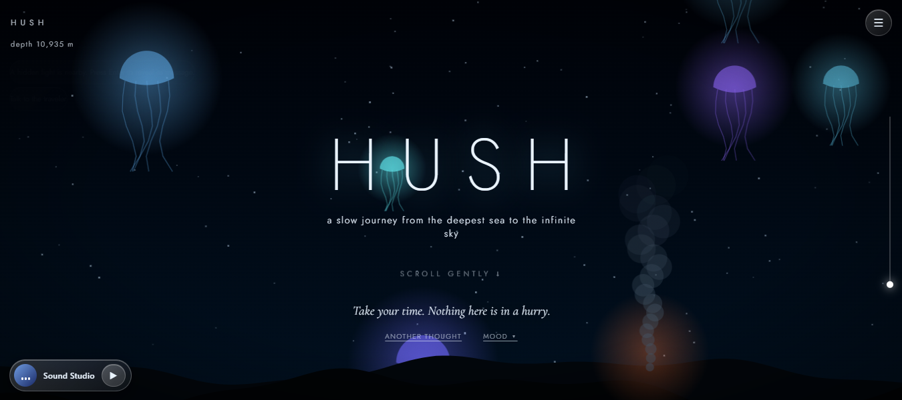
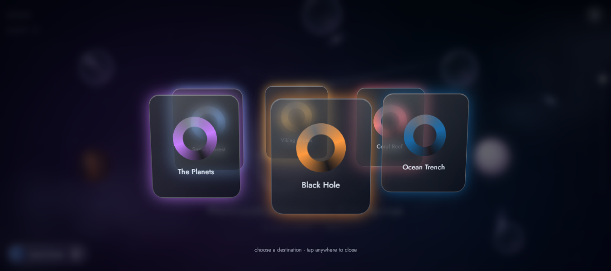
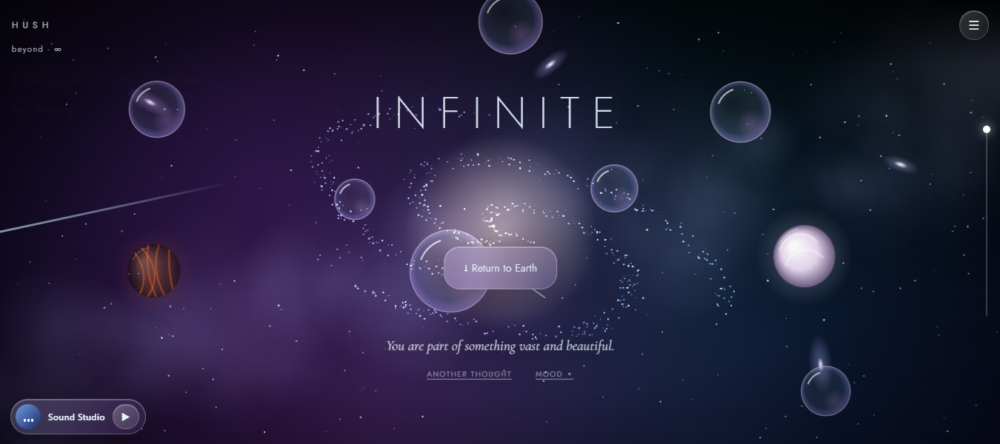

# HUSH

**A slow journey from the deepest sea to the infinite sky.**
HUSH is a calm, single-file web experience: scroll gently through a hand-built world, choose how you feel, and receive quiet, supportive thoughts along the way. No account, no tracking, no build step.



## Features

### The journey
- **One continuous scroll through many worlds:** the abyss with glowing jellyfish, twilight waters, a coral reef, the open sea with a Viking longship, the Vinland meadow, a snowy northern forest under the aurora, the upper atmosphere, planets, a black hole and a distant galaxy.
- **Everything is drawn live on a canvas:** parallax, drifting particles, whales, fish, jellyfish, birds, clouds, stars and shooting stars. No image files are needed.
- **Depth and altitude readout** in the corner and a slim progress line along the edge.
- **Journey map and destinations:** jump to the Ocean Trench, Coral Reef, Viking Shores, Snowy Forest, the Planets or the Black Hole from a rotating glass ring.
- **Daydream mode** drifts between destinations on its own.
- **Hidden lights and runes** appear rarely, and a gentle ending sequence plays at the top.



### Moods and quotes
- Choose how you are arriving: **Overwhelmed, Restless, Lonely, Tired or Curious** (or just explore).
- Each mood has its own collection of 12+ original, supportive quotes that change with the zone you are in.
- **"Another thought"** shows the next quote; your mood stays active for the whole journey.
- **Click the longship** for a short quote about the sea, matched to your mood.
- **Click the planets and the black hole** for thoughts, facts and reflective questions.

### Beyond the horizon
Past the planets, nebulae and a spinning galaxy, the journey ends in the infinite, with a way to return to Earth.



### Sound
- **Ambient mixer:** underwater, whale songs, distant wind, rain, crackling fire, forest and cosmic drone, with saved mixes.
- **Sound Studio:** a compact player that stays available while you explore.
- **Choose your file:** play your own song from your device. Files stay on your device and are never uploaded.

### Wellbeing tools
- **Breathe with the world:** a guided breathing circle.
- **Letters to the Universe:** write a thought, question or something to let go of; it becomes a star you can revisit or delete.
- **Saved places and a constellation map** of what you have discovered.

### Comfort and accessibility
- Minimal interface: one menu button reveals the controls.
- Brightness, intensity and motion settings, and it respects the system *reduced motion* preference.
- Time-of-day tint, responsive layout for desktop and mobile, keyboard focus styles, and Escape to exit.
- Preferences, letters and saved places are stored only in your browser (`localStorage`).

## Run it

HUSH is one HTML file.

1. Download or clone this repository.
2. Open `index.html` in a modern browser. For best results, serve it locally:
   ```bash
   npx serve .
   ```
3. Scroll, or press the menu button for controls.

Fonts (Cormorant Garamond and Jost) load from Google Fonts; the page falls back to Georgia and system fonts offline. Sound starts only after your first click or tap, as browsers require.

## Paid "Choose your file" (setup required)

Choosing your own song is designed as a paid feature. Open `index.html`, find `const PAY_URL=''` and paste your payment link (for example Razorpay or Stripe). The current unlock check is only a **placeholder** (it trusts `?paid=1`), so for real payments verify purchases on a server before unlocking.

## Project structure

```
hush/
├── index.html       # the whole app (HTML, CSS, JavaScript)
├── screenshots/     # images used in this README
├── LICENSE
└── README.md
```

## License

Released under the [MIT License](LICENSE). Copyright (c) 2026 Manash Khati.
